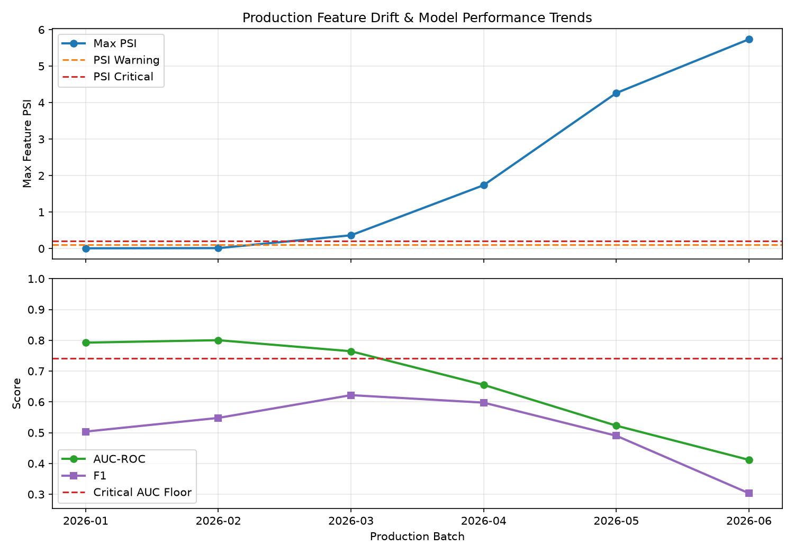

# Production ML Monitoring Dashboard

Monitor credit-risk models in production by tracking covariate shift, categorical drift, upstream data-quality failures, and classification decay across monthly batches. The system flags distribution shifts with statistical tests before ground-truth labels degrade model decisions.



## Quick Start

Install dependencies, train the baseline model, run batch monitoring, and launch the interactive dashboard:

```bash
pip install -r requirements.txt
python src/train.py
python src/monitor.py
streamlit run app.py
```

Run the test suite:

```bash
pytest -v
```

## Dataset and Drift Simulation

The deterministic generator (`src/data_generator.py`, `seed=42`) creates `22,000` credit-risk records across `8` features and a binary `default` target (`28.4%` positive rate on reference holdout):

- Reference window: `10,000` clean records used for training and statistical baselines
- Production batches: `6` monthly slices (`2026-01` through `2026-06`, `2,000` rows each, `12,000` total)
- Numeric features (`6`): `income`, `debt_to_income`, `credit_score`, `utilization_rate`, `account_age_months`, `num_inquiries`
- Categorical features (`2`): `employment_type`, `region`

Batches `2026-01` and `2026-02` stay close to the reference distribution. Starting in `2026-03`, progressive covariate shift, missingness (`0.3%` to `4.4%`), out-of-range corruption, and concept shift degrade both feature stability and discrimination.

## Baseline Model Validation

`src/train.py` fits an `sklearn.pipeline.Pipeline` with median/most-frequent imputation, `StandardScaler`, `OneHotEncoder(handle_unknown="ignore")`, and a `HistGradientBoostingClassifier` (`max_iter=150`, `learning_rate=0.06`, `max_leaf_nodes=31`, `random_state=42`) on an 80/20 stratified reference split:

| Evaluation Split | AUC-ROC | Precision | Recall | F1 |
|---|---|---|---|---|
| 5-fold stratified CV (mean) | 0.7823 +/- 0.0135 | 0.6328 | 0.4269 | 0.5092 |
| Reference holdout (`n=2,000`) | 0.7913 | 0.6463 | 0.4665 | 0.5419 |

## Batch Monitoring Trajectory

Running `python src/monitor.py` against the baseline artifacts produces the following monthly progression:

| Batch | Status | Max Feature PSI | AUC-ROC | Missing Rate | Alerts |
|---|---|---|---|---|---|
| `2026-01` | OK | 0.008 | 0.7924 | 0.003 | 0 |
| `2026-02` | WARNING | 0.013 | 0.8003 | 0.005 | 3 |
| `2026-03` | CRITICAL | 0.364 | 0.7644 | 0.011 | 8 |
| `2026-04` | CRITICAL | 1.737 | 0.6553 | 0.019 | 12 |
| `2026-05` | CRITICAL | 4.262 | 0.5228 | 0.032 | 15 |
| `2026-06` | CRITICAL | 5.736 | 0.4118 | 0.044 | 15 |

## Key Findings

1. Two-sample KS and Chi-square tests catch early shift in `2026-02` (`3` `WARNING` alerts at `max_psi=0.013`), one month before feature PSI crosses the `0.20` critical ceiling in `2026-03` (`max_psi=0.364`).
2. Concept and covariate drift from `2026-04` to `2026-06` drops holdout `AUC-ROC` from `0.7913` to `0.4118`, exceeding the `0.05` critical decay limit.
3. Missingness rises to `4.4%` alongside negative `debt_to_income` and `>850` `credit_score` records in `2026-06`. Per `docs/RETRAINING_PLAYBOOK.md`, upstream ingestion defects must be quarantined before fitting a replacement model.

## Repository Layout

- `app.py` - Interactive Streamlit dashboard with threshold sliders, cached computation, and `en`/`id` localization
- `src/schemas.py` - Strict Pydantic v2 schemas (`extra="forbid"`, `allow_inf_nan=False`)
- `src/guardrails.py` - Path traversal checks, row bounds, finite array coercion, and SHA-256 + `hmac.compare_digest` verification before `joblib.load`
- `src/i18n.py` - `Babel`-backed `en` and `id` catalogs and number/percent formatters
- `src/data_generator.py` - Deterministic reference and drifted monthly batch simulator
- `src/drift.py` - Quantile-binned PSI, two-sample KS, Chi-square, and data-quality checks
- `src/performance.py` - Binary classification metrics (`AUC-ROC`, `Precision`, `Recall`, `F1`)
- `src/alerting.py` - Configurable threshold evaluation for `WARNING` and `CRITICAL` alerts
- `src/train.py` - Cross-validated training pipeline, schema validation, and SHA-256 digest export
- `src/monitor.py` - CLI batch evaluator exporting `reports/monitoring_report.json` and trend plots
- `docs/RETRAINING_PLAYBOOK.md` - Trigger matrix, pipeline isolation rules, shadow evaluation, and rollback steps
- `notebooks/01_eda.ipynb` - Exploratory drift and missingness analysis
- `notebooks/02_modeling.ipynb` - Baseline training and monitoring walkthrough
- `tests/test_monitoring.py` - Unit and end-to-end integration tests (`98%` line coverage across `src/`)
- `.github/workflows/ci.yml` - Manual-only (`workflow_dispatch`) verification workflow

## Methodology and Limitations

Drift detection decouples distribution shifts (reference quantile PSI, two-sample KS, Chi-square) from ingestion quality (missingness, duplicates, schema range bounds) and supervised evaluation. Every model deserialization call (`joblib.load`) validates path containment, file size limits, and SHA-256 integrity against `models/baseline_model.sha256`.

Supervised metrics assume ground-truth `default` labels arrive for each monthly batch. In live lending portfolios where repayment outcomes lag by 30 to 90 days, feature PSI, KS p-values, and predicted positive-rate shifts act as leading indicators until labeled outcomes mature.
